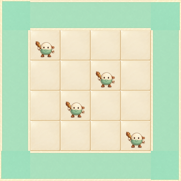

# 모모 아트 후보 round-01

Issue #4 / generation 1 / candidate, not production.

[864px comparison](board-864.png) · [Manifest](manifest.json) · [Numeric checks](checks.json) · [Prompts](prompts.json)

## 실제 확인
모모가 생성된 네 조각과 조립판의 픽셀을 직접 확인했다. 지정 imagegen으로 아트 픽셀을 생성했고, assemble.py는 원본을 축소·회전·알파 합성하여 조립할 뿐 아트를 그리지 않는다. 각 원본은 1254×1254다. 360판은 셀60px, 864판은 셀144px다. 기물 원본 캔버스는 정사각이라44×48 표시박스에서44×44로 맞춰지며, alpha≥128 실루엣은37×32px이다. 이는 실루엣44×48을 달성했다는 뜻이 아니다.

크림판과 민트길의 영역 구분, 기물의 발·얼굴·도토리 발사기 실루엣은 작은 판에서 읽힌다. 경로는 UI 화살표를 아직 추가하지 않아 방향을 표시하지 않는다. UI 글자·별·체력은 원본 PNG에 없다.

## 자기 점검과 남은 문제
- 처음 직선 타일의 돌무늬와 모서리의 어두운 내부 무늬를 재생성으로 제거했다. corner-v1-rejected.png는 사용하지 않는 최초 모서리이며 조립/manifest의 활성4조각에는 포함하지 않는다.
- 새 직선/모서리에도 미세한 색과 가장자리 두께 차이가 남는다. 360판 경로 연결부 RGB 평균 절대차는1.1556–9.1778/255. 수치만으로 seamless 통과라고 판정하지 않는다.
- 원본 기물에는 저알파 잔여가 하단 캔버스 경계까지 이어진다. 밝은 판에서는 눈에 띄지 않지만 어두운 배경·확대 확인이 필요하며 제작용 승인 사유로 삼지 않는다.
- 기물의 민트 하체가 길과 비슷하다. 현재는 크림 배치판 위 아군만 상정했으며 적으로 재사용하지 않는다. 적 실루엣과 함께 비교해야 한다.
- 원본 참고의 풍성한 상점 배경/금빛 테두리는 이번 작은 모듈 범위 밖이다. 이 판은 완성 UI나 게임 실행 화면이 아니다.
- 광원 회전, 실루엣 표시크기, 경로 이음은 두 독립 동료의 검토 대상. 자기 검사는 독립 승인으로 계산하지 않는다.

## 재현
Python3+Pillow 환경에서 `python assets/candidates/round-01/momo/assemble.py`를 실행한다. 원본4 PNG는 수정하지 않는다. 반복 실행 결과의 SHA를 비교할 수 있다. 모든 파일은 후보 범위이며 main 병합/production 채택/게임 플레이는 아직 없다.
