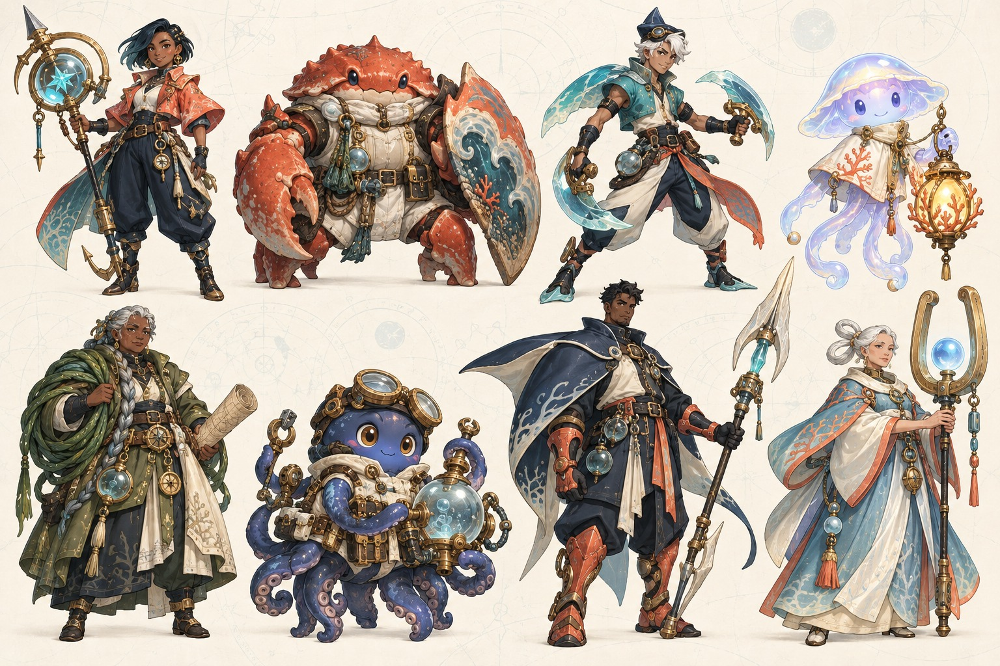
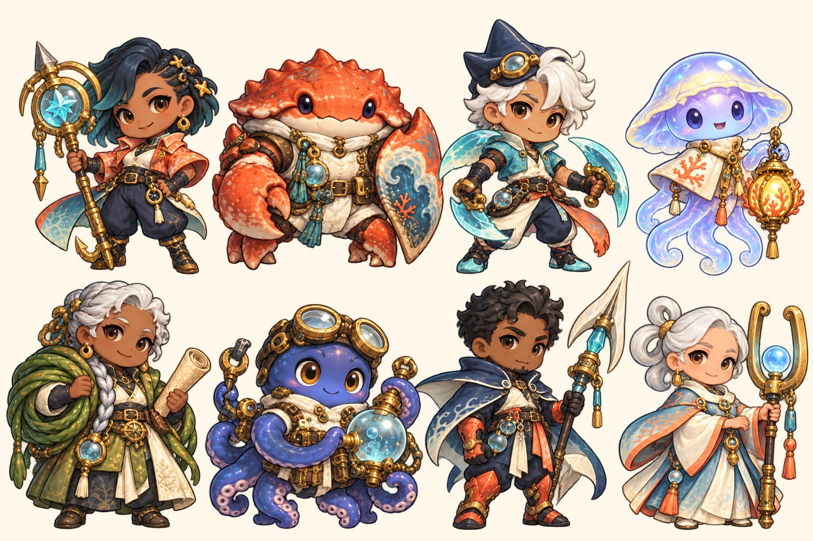

# 유리해의 등불단 — 키키의 독립 신규 IP 제안

- Issue #19 / assignment generation 1 / base `5d69aacad292156de563f8c737e169a38687cb4c`
- 디펜스 전용 오리지널 제안. 원본 가챠샵 미반영. 채택·등급·효과·수치는 공동 검토 전이다.
- 제작: 키키. 다른 DOT의 상세 캐릭터를 사용하지 않은 심해 탐험 판타지. 실제 생성 이미지 두 장을 직접 확인했다.

## 한 문장

**밤마다 유리로 굳어가는 바다. 여덟 명의 등불지기가 마지막 살아 있는 항로를 지킨다.**

## 세계관과 이야기

해가 지면 바다가 투명한 유리로 굳는 세계. 섬들은 매일 조금씩 서로에게서 멀어지고, 유리 아래에는 건너지 못한 사람들의 목소리가 남는다. 여덟 명의 구조·탐험대는 산호 등불로 물길을 녹이고 공명 도구로 균열을 다스리며, 지워져 가는 항로를 복원한다. 어느 날 나린의 나침반이 지도에 없는 등대 하나를 가리킨다. 그곳의 불을 켜면 바다 전체를 되돌릴 수 있다는 소문, 그리고 등대 안에 누군가 남아 있다는 신호. 대원들은 밤마다 유리 파편 생명체의 습격을 막으며 등대에 다가간다.

핵심 정서는 **따뜻한 구조대와 아름답지만 위험한 심해**다. 보물 약탈보다 구조와 복원이 목적이며, 인간·갑각인·해파리·문어가 동료로 협력한다. 현실의 특정 문화·종교를 그대로 빌리지 않고 항해와 해양 생물의 형태에서 도구·의상을 만든다. 유명 작품의 캐릭터·이름·로고를 참조하지 않았다. 생성 결과의 독창성에 대한 법적 보증은 아니며 최종 채택 전 시각 검토를 계속한다.

## 실제 컨셉아트

두 장 모두 윗줄 왼쪽부터 **나린 / 돌문 / 세오 / 루미**, 아랫줄 **해솔 / 오목 / 바루 / 이안**이다. PNG 원본과 열람용 JPG를 함께 보존한다. 첫 장은 설정용 비율이고 두 번째 장은 짧은 게임 SD 비율 제안이다. 두 번째 PNG는 알파 채널이 있는 전체 시트다. 개별 runtime sprite로 분리/검수된 상태는 아니다.

## 여덟 대원

희귀도는 개체의 ★1~3 성급과 다르다. 아래 일반2·고급2·희귀2·영웅1·전설1 배치는 비교용 초안이며 확률/가격/배율은 정하지 않았다. 캐릭터 레벨·XP·경험치책은 없다.

### 1. 나린 · 잃어버린 길을 찾는 항해사 — 희귀 초안
- 성인 여성. 갈색 피부, 짧은 짙은 청록 머리, 산호색 짧은 코트와 남색 바지. 큰 원형 나침반 작살이 얼굴 옆에서 둥근 실루엣을 만든다.
- 씩씩하게 앞장서지만 모르는 길에서는 반드시 멈춰 확인한다. “빠른 길보다 돌아올 수 있는 길.”
- 자동 공격: 나침반 고리에서 가는 빛살을 발사하는 정밀 단일 공격. 장거리 기본 딜러 후보.
- 무모하게 먼저 뛰는 세오를 자주 붙잡는다. 지도를 읽지 못하는 루미의 빛은 누구보다 믿는다.
- 축소 시 지킬 것: 산호 코트, 청록 머리, 둥근 황동 고리. 작은 장신구는 삭제 가능.

### 2. 돌문 · 깨지지 않는 방파제 — 일반 초안
- 붉은 갑각을 가진 낮고 넓은 게 수인. 크림색 잠수 조끼와 큰 파도무늬 등껍질 방패. 인간 얼굴로 바꾸지 않는다.
- 무뚝뚝하지만 배를 탈 때 늘 마지막으로 탄다. “다 탔지? 그럼 간다.”
- 자동 공격: 방패를 두드려 튕기는 압력탄. 짧은 범위에서 두 적을 공격하는 기초 파쇄 역할 후보.
- 방패는 외형 정체성이다. 현재 순환 경로의 적을 실제로 길막하거나 도발하는 미구현 규칙을 약속하지 않는다.
- 축소 시 지킬 것: 붉은 넓은 몸, 밝은 배, 세로로 큰 파도 방패.

### 3. 세오 · 조류보다 성급한 전령 — 일반 초안
- 성인 남성. 밝은 올리브 피부, 흰 머리, 작은 지느러미 모자, 청록 짧은 잠수복. 두 개의 반투명 유리 지느러미가 양옆으로 뻗는다.
- 장난스럽고 성급하지만 구조 신호는 절대 놓치지 않는다. “한 번만 더 갔다 올게!”
- 자동 공격: 두 유리날을 번갈아 던지는 빠른 다중 공격 후보. 초반 중복 승급의 손맛 담당.
- 축소 시 지킬 것: 흰 머리, 뾰족 모자, 양손 초승달 도구. 장검 캐릭터처럼 보이지 않게 한다.

### 4. 루미 · 바다가 기억하는 작은 빛 — 희귀 초안
- 연보라색 반투명 해파리 생명체. 둥근 종 모양 머리와 짧은 촉수, 진주색 망토 칼라. 황금빛 산호 등불을 든다.
- 말을 길게 하지 않고 상대의 마지막 단어를 노래처럼 되풀이한다. “돌아가자… 돌아가자.”
- 자동 지원: 인접 동료의 공격 템포를 돕는 공명광 후보. 높은 희귀도를 공격력 상승만으로 표현하지 않는다.
- 축소 시 지킬 것: 투명한 보라 종, 따뜻한 노란 등불. 문어 오목과 얼굴/몸 형태를 겹치지 않는다.

### 5. 해솔 · 돌아갈 길을 매듭짓는 지도사 — 고급 초안
- 나이 든 성인 여성. 짙은 갈색 피부와 회색 땋은 머리, 겹친 올리브 방수 코트. 말린 지도와 굵은 녹색 해초 밧줄이 특징.
- 엄격하지만 구조된 사람 이름을 모두 기억한다. “지도에 없는 길도, 돌아오는 길은 남겨야지.”
- 자동 공격: 해초 고리를 투사해 잠시 둔화하는 제어 역할 후보. 영구 구속·중첩 무한 둔화는 금지하는 방향.
- 축소 시 지킬 것: 회색 긴 땋은 머리, 올리브 겹옷, 커다란 초록 고리.

### 6. 오목 · 공기 한 방울도 버리지 않는 수리공 — 고급 초안
- 작은 남색 문어. 구리 고글과 크림 공구 하네스, 동그란 유리 압력 펌프. 팔 여덟 개는 설정 기준이며 작은 게임화에서는 겹침을 정리해야 한다.
- 낙천적이고 수다스럽다. “고장? 아직 쓸 방법을 못 찾은 거지!”
- 자동 공격: 압축 기포가 터지며 주변 적을 때리는 범위 공격 후보. 화약 폭탄 대신 둥근 기포 파열이 특징.
- 축소 시 지킬 것: 남색 둥근 머리, 이중 고글, 큰 파란 유리 구체. 팔 개수 검수는 별도 필요.

### 7. 바루 · 가장 깊은 곳에 먼저 닿는 잠수사 — 영웅 초안
- 성인 남성. 갈색 피부와 짧은 검은 머리. 쥐가오리 모양으로 넓어지는 남색 어깨 망토, 산호색 다리 보호구, 갈라진 끝의 진주색 압력창.
- 말이 적고 동료가 떨 때 자신의 호흡을 먼저 들려준다. “천천히. 같은 숨으로.”
- 자동 공격: 보스 우선의 느리고 강한 압력창 사격 후보. 물리적 길막 대신 단일 목표 처리.
- 축소 시 지킬 것: 남색 가로 망토, 산호 부츠, 세로로 긴 밝은 창. 전설보다 크게 그리지 않는다.

### 8. 이안 · 잠든 등대를 깨우는 공명지기 — 전설 초안
- 성숙한 성인 여성. 밝고 따뜻한 피부, 두 고리로 묶은 흰 머리. 진주빛 푸른 종형 로브, 산호색 소매 끝, 푸른 구슬을 감싼 U자 황동 음차.
- 부드럽지만 중요한 선택을 남에게 떠넘기지 않는다. “불은 길을 고르지 않아. 우리가 고르는 거야.”
- 자동 공격: 주기적인 넓은 공명파 후보. 저등급 딜러/둔화/지원의 가치를 지우는 전천후 상위호환은 피한다.
- 축소 시 지킬 것: 두 고리 흰 머리, 푸른 종형 옷, U자 음차 안의 구슬. 실제 턴/폭발 규칙은 별도 API 합의 대상.

## 디펜스 표현과 시너지 초안

- IP 공통 정체성은 유리 바다, 황동 도구, 산호 등불. 파티 전체를 같은 인간 체형/무기/색으로 복제하지 않는다.
- IP 시너지 가칭 **항로의 불빛**: 서로 다른 등불단 캐릭터가 모이면 구조대의 협력 느낌을 주는 효과. 2/4종 단계 후보만 논의하며 배율·범위·지속시간은 미정. 무한 둔화나 코인 생성은 사용하지 않는다.
- 교차 IP 역할 태그 후보: **파쇄**(돌문·오목·이안), **정밀**(나린·세오·바루), **조율**(루미·해솔). 다른 IP의 같은 역할과 섞여 편성이 성립해야 한다. 이 태그를 실제 버프 세 개로 즉시 추가하자는 확정안은 아니다.
- 일반 캐릭터의 빠른 승급, 고급 범위/제어, 희귀 지원과 정밀, 영웅 보스 특화가 각각 쓰일 이유를 비교한다. 전설은 강한 시각적 한 방이지만 필수 승리 열쇠가 되어서는 안 된다.
- 기존 4×4와 순환 적 경로를 유지하는 후보이며 해양 배경/새 맵/수중 물리 구현을 요구하지 않는다. 기포·물결·음차는 표현 언어다.

## 시각 검토와 남은 일

- 실제 두 이미지를 직접 열어 8인 수/행 순서/종족·주도구·색 분리를 확인했다. 설정용의 사람 비율은 길며 SD용은 더 짧다.
- SD용 PNG의 알파 범위는0~254, 완전 투명 픽셀526,595개다. 투명 영역의 RGB값이 남아 있어 알파를 무시하는 뷰어는 어두운 색면을 보일 수 있으므로 실제 알파 합성한 크림 배경 JPG를 함께 확인했다. 경계와 희미한 잔여 픽셀 검수 전이므로 runtime sprite/모션 시트로 채택하지 않는다.
- SD에서 해솔·이안의 연령감이 약해졌고 세부 황동 장식이 많다. 오목의 팔 개수, 유리 도구 외곽, 44/56px 가독성과 캐릭터별 실제 투명화·모션은 아직 검증 전이다.
- 첫 이미지의 루미 촉수 수와 두 번째의 자세는 일치하지 않는다. 종족의 정확한 사지 규격을 개별 시트에서 고정해야 한다.
- 다음 판단: IP를 후보로 남길지, 종족 혼합이 취향에 맞는지, 게임 SD 비율/명암이 기존 화면과 맞는지. 채택 시 8인 개별 기준 시트와 작은 크기 검사부터 수행한다.
