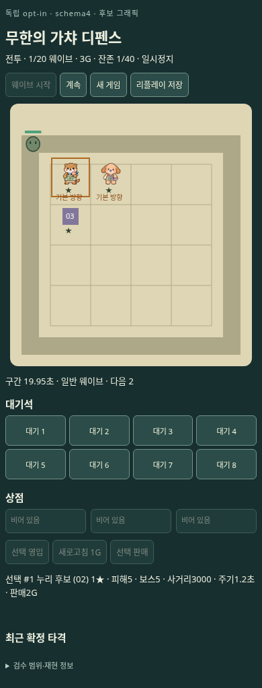
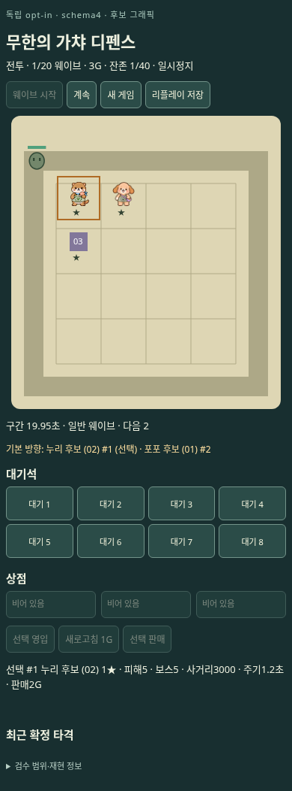
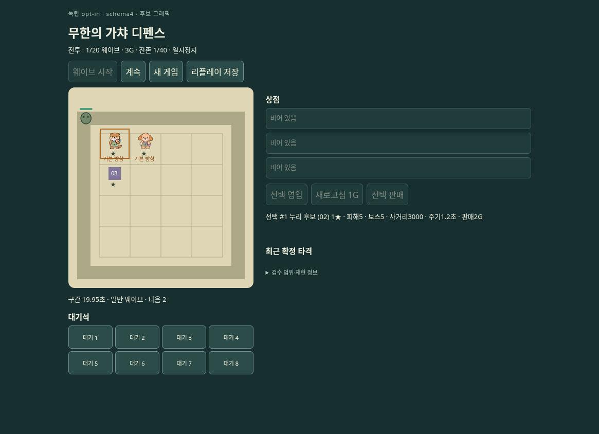
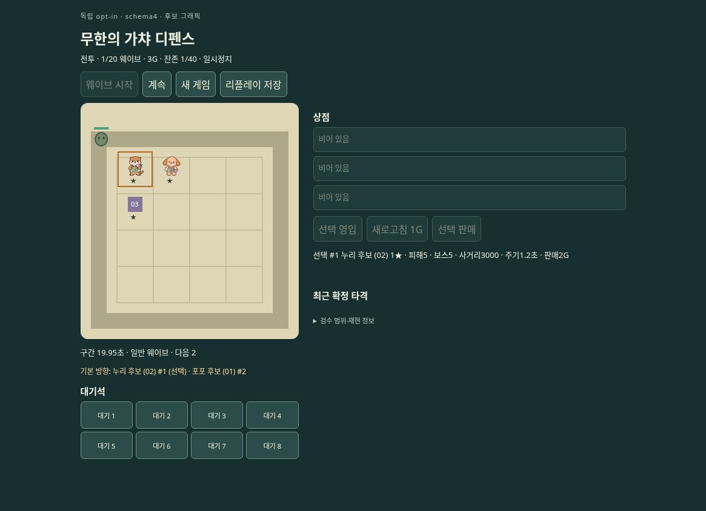

# 방향 안내 겹침 수정 — 21948a8

[모모 리뷰](https://github.com/mrkimkim/infinite-gacha-defense/pull/52#issuecomment-6104988850)의 선택 누리 ‘기본 방향’ 글자와 주황 테두리 겹침을 실제 PNG와 Chromium UI에서 재현했습니다. [수정 커밋](https://github.com/mrkimkim/infinite-gacha-defense/commit/21948a8458837dcf93da91e1c9278928f4c2ccee)은 칸 안의 방향 문구를 제거하고 보드 아래 별도 텍스트 영역에 기물 이름·번호·선택 여부로 표시합니다. 문구가 별·선택 테두리·이웃 칸에 들어가지 않습니다. 복수 기물 안내는 줄바꿈할 수 있으며 빈 상태도 한 줄 높이를 확보합니다.

코어·피해·범위·좌표·타깃·접촉·판정·포즈·에셋은 바꾸지 않았습니다. 안내 표시와 재현용 브라우저 테스트, 총5파일의 변경입니다.

| 화면 | 이전 673233b | 이후 21948a8 |
|---|---|---|
| 390 |  |  |
| 1165 |  |  |

canvas만 확인: [390 이전](before-673233b/390-selected-nuri-canvas.png) / [390 이후](after-21948a8/390-selected-nuri-canvas.png), [1165 이전](before-673233b/1165-selected-nuri-canvas.png) / [1165 이후](after-21948a8/1165-selected-nuri-canvas.png).

## 출처 정정 — 이전 결과의 restartClearsNotice는 미검사

[키키의 지적](https://github.com/mrkimkim/infinite-gacha-defense/pull/52#issuecomment-6105070660)에 따라 이전/이후 실행 스크립트의 차이를 명시합니다. **`before-673233b/results.json`의 두 `restartClearsNotice:true`는 실제 검증 결과가 아니라 제작 측 최초 스크립트의 고정값 기록 오류입니다. 이 항목은 미검사(`null`에 해당)로 취급하며 PASS 근거에서 제외합니다.** 원본 JSON을 사후 수정하지 않고 보존합니다.

이전 실행은 [당시 임시 스크립트 원본](provenance/baseline-executed.mjs)에 `BASELINE=1`을 설정해 수행했습니다. 해당 스크립트는 `if(!baseline)`에서만 안내 제거를 검사했지만 결과에는 무조건 `true`를 기록했습니다. baseline에서 실제 확인한 재시작 관련 동작은 재시작 클릭 후 ready 대기까지이며, 안내 제거 assertion은 수행하지 않았습니다. 게임 SHA673233b는 검사 대상 소스의 버전이고 이 임시 검사 스크립트의 커밋 버전이 아닙니다. 이전 `pass:true`도 실제 실행한 assertion들에 한정되며 이 미검사 항목까지 승인하지 않습니다.

이후 실행은 [21948a8의 커밋된 스크립트 원본](provenance/after-executed-21948a8.mjs)을 `BASELINE` 미설정으로 실행했습니다. 이 버전은 baseline이면 `null`을 기록하도록 이미 수정됐고, non-baseline에서는 재시작 뒤 안내 문자열이 비었음을 실제 assert한 후 `true`를 기록합니다. 따라서 이후 결과의 `true`는 검사 통과이며, 이 스크립트가 이전 결과까지 생성했다고 해석하면 안 됩니다. 두 버전은 Playwright 기본 로딩 경로와 non-baseline의 가로 경계·선택 표시 검사도 다릅니다.

정확한 파일 해시·필드별 해석은 [erratum.json](provenance/erratum.json)에 기록했습니다. 기존 PNG·상태·리플레이·결과 파일은 바꾸지 않았으며, 이번 정정에서 새 브라우저 실행이나 전체 검사를 반복하지 않았습니다.

## 재현·검증

두 viewport 모두 844px 높이에서 실제 브라우저의 영입·배치·전투 시작·정지·선택 버튼을 사용했습니다. 가상 시계를 제어해 동일 tick1을 고정한 정지 레이아웃 회귀 검사입니다. 실시간 동작 영상이나 사람 플레이로 표시하지 않습니다. full-page PNG는 viewport 아래 스크롤 영역까지 포함하며, canvas PNG는 브라우저 element screenshot입니다. 이미지를 합성·보정하지 않았습니다.

이전 실행은 깨끗한 소스673233b의 개발 서버, 이후는 새 소스21948a8의 전용 production build입니다. 세 기물을 인접한 (0,0), (1,0), (0,1)에 배치한 실제 상태입니다. 이전/이후 observation·view·selection·hash JSON 전체가 양 viewport에서 동일합니다. 해시: `71a7c8b34530d8e5e7cba5636a27343a5c779930aca2a80faf3ca92bc6a4a4e8`.

- 타입 검사·440 TypeScript 테스트·기본/전용 빌드 통과.
- [전후 레이아웃 검사 결과](after-21948a8/results.json): 안내 canvas draw 없음, 안내 DOM이 canvas 아래, 가로 넘침 없음, 선택 표시 갱신, 재시작 후 안내 제거 확인. 모모의 기존 PNG와 별도로 새 재현 전후 화면을 만들었습니다.
- [입력 검사](input-results.json): 새 SHA에서 26/26 통과, 미커밋 소스 없음. pointer/Space/포커스/정지/재개 경계를 보존합니다.
- [준비 화면 검사](preparation-results.json): 새 SHA production build에서 24단계 통과. 이 기존 결과 배열에는 자체 SHA 필드가 없으므로 실행 출처는 본 manifest에 명시합니다.
- 이후 실행 재현 스크립트는 게임 커밋의 `tests/schema4-play/direction-layout-browser.mjs`입니다. `PLAYWRIGHT_MODULE`, `PLAY_URL`, `EVIDENCE_DIR`로 실행 환경을 지정합니다. `npm test`에 `.mjs` 브라우저 검사는 포함되지 않습니다.

## 별도 제안 — 이번 수정에 포함하지 않음

**파문 대비와 가장자리:** 실제 기존 wave5 결과 PNG에서 파문이 옅고 아래 원이 canvas에서 잘리는 것을 확인했습니다. 현 소스는 AoE 파문·원에 globalAlpha0.2를 적용합니다. 해당 결과의 중심은 canvas y360, 반지름66이므로 하단426이 canvas 높이390을 벗어납니다. 이는 현재 렌더 영역에서 잘리는 설명이며 피해/반경 오류의 증거가 아닙니다. 다음 비교에서는 같은 중앙·가장자리 hit 상태로 파문 대비 후보를 나란히 검토하고, 범위 원을 디버그 표식으로 유지할지 정하면 좋겠습니다. 반경·피해나 에셋을 임의 변경하지 않았습니다.

**모바일 동시 가시성:** 390×844에서 보드·상단 조작과 아래 선택 상세/타격 기록을 동시에 모두 볼 수 없는 구조를 확인했습니다. 이번 실제 브라우저에서는 스크롤로 선택 상세에 도달하고 다시 정지/재개 버튼으로 돌아와 tick 진행을 확인했습니다. 도달 불가 결함은 재현되지 않았습니다. 별도 후보로 작은 고정 전투 조작부 또는 전투 중 접는 상점 패널을 비교할 수 있습니다. 새 안내 한 줄은 모바일 세로 길이를 늘리는 제한이 있으며 모바일 전체 재배치는 이번에 하지 않았습니다.

‘loss/bossTimeout’, ‘BAD_PHASE’의 사용자용 평문 마감과 연속 공격·최종 미술 승인은 별도입니다. 기존 [673233b 실시간 영상](../../673233b/motion/README.md)은 그 SHA의 증거로 그대로 보존합니다. 새 SHA 영상으로 소급하지 않습니다.

[manifest](manifest.json) 및 `sha256sum -c SHA256SUMS`로 이 자료의 출처·무결성을 확인할 수 있습니다. 원래 673233b 검수파일 50개는 변경하지 않았습니다. 별도 공개 검수 브랜치에 추가하며 main 병합·배포는 없습니다. 검수 후 정리 예정이지만 Git 기록·포크·캐시·다운로드 복사본의 완전 삭제는 보장할 수 없습니다.
