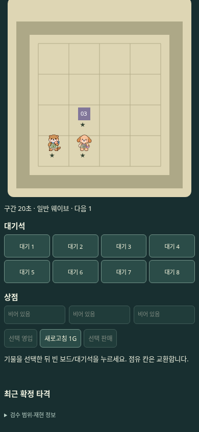
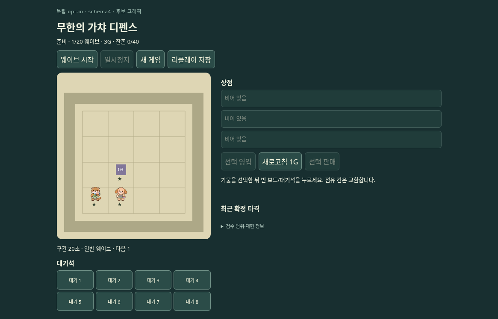
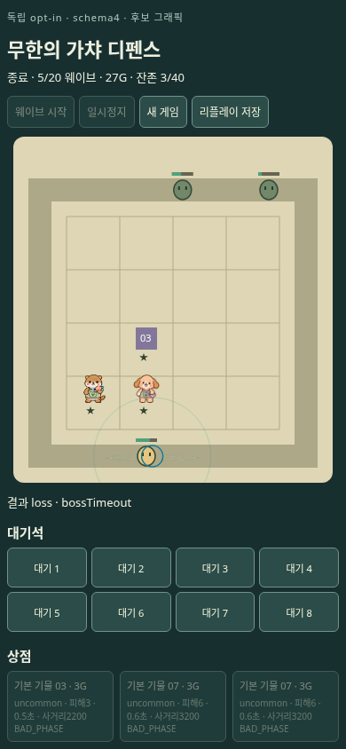
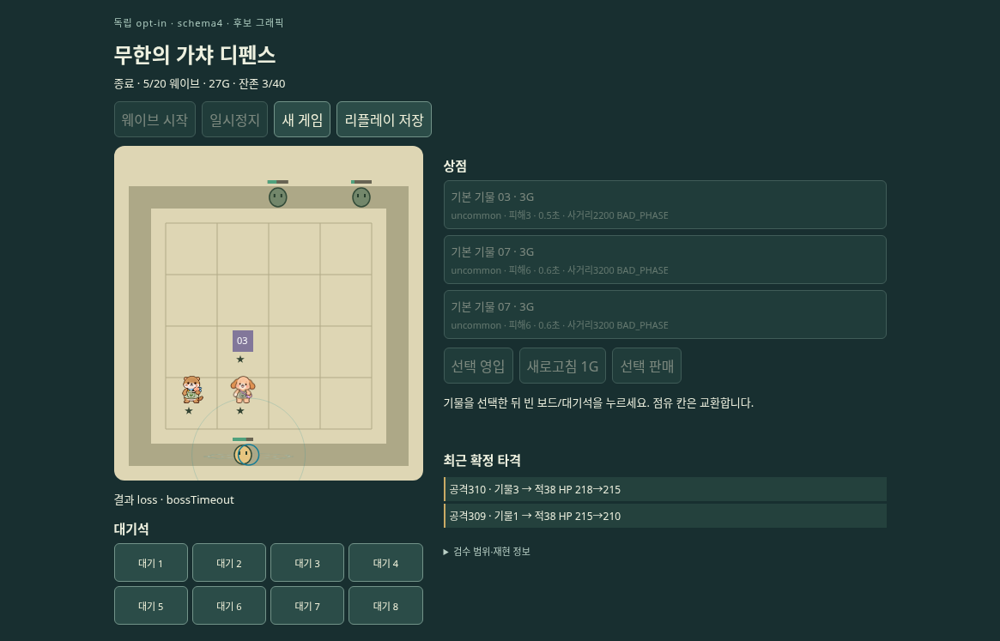
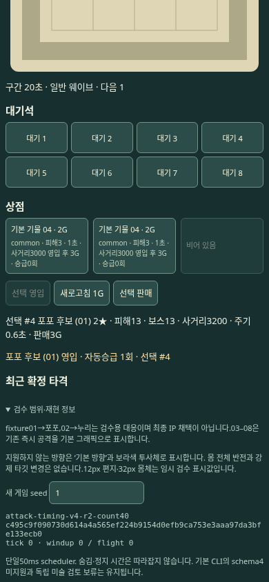
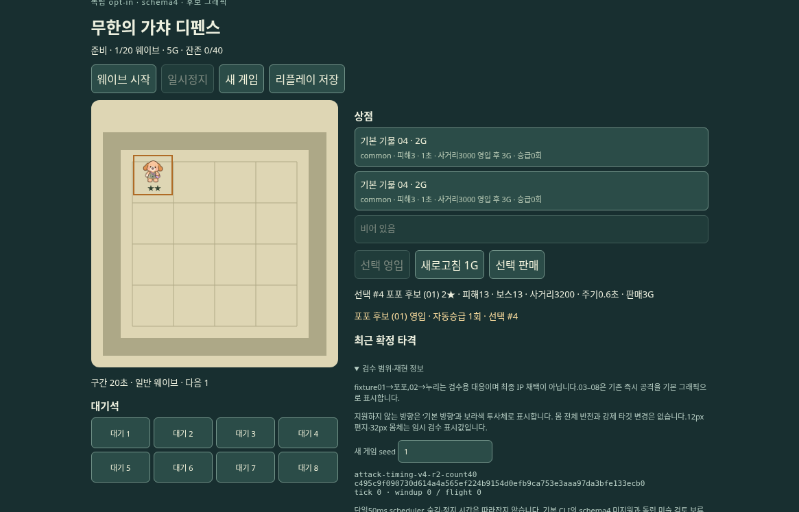

# PR52 673233b — 선별 검수 자료

검사한 게임 소스는 **`673233bdea7c32663deb6cbb155ee18a0019f15b`**입니다. 이 브랜치의 자료 게시 커밋과 검사 대상 게임 SHA는 구분합니다. [게임 변경 PR52](https://github.com/mrkimkim/infinite-gacha-defense/pull/52)의 제작 측(producer) 브라우저 실행 자료이며, 독립 동료의 시각 승인이나 사람 플레이 결과가 아닙니다.

공개가 승인된 이 게임의 선별 화면·리플레이·검사 결과·재현 기록만 포함합니다. 원본 39개는 변경 없이 복사했습니다. [manifest.json](manifest.json)은 파일별 크기·SHA256·출처를, [SHA256SUMS](SHA256SUMS)는 이 폴더의 파일 무결성을 기록합니다. 과거 `82be2fe`·`78b34ac` 영상이나 검수 자료를 최신 자료로 섞지 않았습니다.

## 빠른 화면 확인

| 장면 | 390 × 844 | 1165 × 747 |
|---|---|---|
| 영입·배치 |  |  |
| 결과 |  |  |
| 별도 seed1 자동승급 |  |  |

나머지 화면: [390 정상 실행](normal/390/), [1165 정상 실행](normal/1165/), [입력 검사](input/), [준비 화면 회귀 검사](preparation/).

## 포함 범위와 읽는 순서

1. **정상 속도 실행:** [390 결과](normal/390/results.json), [1165 결과](normal/1165/results.json). 실제 UI로 seed5에서 세 기물을 영입·배치하고 정지/재개, 공격, 1–5웨이브, `bossTimeout` 패배 결과를 확인했습니다. 이후 새 게임 seed1에서 실제 자동승급과 재시작을 검사했습니다. 각 폴더에 정지·1웨이브 경계·결과·승급·최종 재시작 PNG와 결과/승급 리플레이를 포함합니다.
2. **가상 시계 실행:** [390 결과](clock-controlled/390/results.json), [1165 결과](clock-controlled/1165/results.json). 별도 clock-controlled 검사입니다. 정상 속도 영상으로 취급하지 않습니다. 이 최소 묶음에는 가상 시계 결과 요약만 포함합니다.
3. **입력 안정성:** [결과](input/results.json). 제작 측 built-preview Chromium에서 두 viewport 합계26/26 검사 통과. pointer 누름/놓기 사이 repaint, Space 입력, 정지/재개 후 입력 등의 선별 PNG를 포함합니다. 정지 PNG 하나로 입력 시간 순서를 입증할 수는 없습니다.
4. **준비 화면:** [결과](preparation/results.json). 같은 소스673233b에서 기록한24단계 canvas 검사 중 교환·모두 판매·승급 PNG를 골랐습니다. 이 원본 결과 배열 자체에는 SHA 필드가 없어, 제작 당시 실행 기록과 원본 검수 폴더의 대응을 manifest의 producer 출처로 명시했습니다. 원본을 사후 편집해 SHA를 삽입하지 않았습니다.
5. **재현 기록:** [정상 로그](reproduction/normal-run.log), [가상 시계 로그](reproduction/accelerated-run.log), [프레임 통계](reproduction/normal-frame-verification.json), [정상 실행 원본 스크립트](reproduction/fullplay-normal-executed.mjs), [가상 시계 실행 스크립트](reproduction/fullplay.mjs).

네 실행은 모두 tick2082·wave5·`loss/bossTimeout`과 동일한 결과 상태 해시를 기록했습니다:

```text
3e1ff7c4483e6258fc30d997fe943e6400602059fc28e3cc306317e4f6b1710d
```

정상 실행 리플레이는 [390](normal/390/wave-5-boundary-replay.json), [1165](normal/1165/wave-5-boundary-replay.json)에 있습니다. schema4 리플레이 검증은 이 커밋의 `src/core-timing/index.ts` `replay(header, entries, finalHash)`를 사용합니다. 기본 CLI의 schema4 지원을 주장하지 않습니다.

## 이 최소 묶음으로 확인할 수 없는 것

**MP4·원본11645프레임·개별 endpoint 증명 프레임·전체 audit/snapshot·빌드·ZIP은 포함하지 않았습니다.** 결과 JSON에 나오는 원본 절대경로/endpoint 파일명은 제작 당시 로컬 기록이며, 이 저장소에서 열리는 링크가 아닙니다. 프레임 통계·endpoint 일치 수치도 제작 측 검증 보고입니다. 여기 있는 정지 이미지와 로그만으로 투사체 연속성, 모든 중간 포즈, 전체 영상 무결성 또는 최종 미술 승인을 확정하지 마세요. 연속 동작 검수에는 원본 영상/프레임의 별도 전달과 확인이 필요합니다.

정상 녹화 원본은 각각 약112.6초였고, 원래 시각 간격으로 보존했습니다. 프레임 간격은 일정하지 않으며 최대 약2.25초의 간격도 원본에 있습니다. 원본 기록의 존재와 이번 최소 묶음에 포함된 범위를 구분합니다. 검증한 결과는 5웨이브 패배 경로이며, 20웨이브 승리나 최종 치명타 승리 경계가 아닙니다.

## 재현과 무결성

원본 producer 스크립트에는 당시 `/workspace/scratch/...` 및 Playwright 설치 절대경로가 남아 있습니다. 실행 환경에 맞춘 경로 설정이 필요하며, 그대로 범용 실행 가능한 배포 스크립트라고 주장하지 않습니다. 일반 입력/준비 재검사는 검사 대상 소스의 `tests/schema4-play/input-browser.mjs`, `tests/schema4-play/preparation-browser.mjs`를 사용합니다. Playwright/Chromium과 기록 도구는 별도 환경 의존성입니다. `npm test`에는 이 브라우저 `.mjs` 실행이 포함되지 않습니다.

파일 검증은 이 폴더에서 `sha256sum -c SHA256SUMS`로 할 수 있습니다. manifest는 승인된39개 payload의 원본 해시를 별도로 제공합니다. SHA256SUMS는 자기 자신을 제외한 자료와 README/manifest를 포함합니다. 게임 구현 파일은 이번 자료 게시에서 변경하지 않았습니다.

## 보관과 정리

현재는 **별도 공개 검수 브랜치**로 유지하며 main에 병합하거나 배포하지 않습니다. 검수 후 자료 정리를 예정하고 있습니다. 다만 브랜치/파일을 나중에 삭제하더라도 Git 기록·포크·캐시·다운로드된 복사본의 완전 삭제를 보장하지 않습니다. 공개 범위에는 비밀정보·개인 대화·연결 장애 진단/세션 로그가 포함되지 않습니다.
