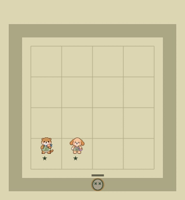

# 준비 단계 recovery → idle 수정 — ae11d1b

[PR52 코드](https://github.com/mrkimkim/infinite-gacha-defense/commit/ae11d1b03a070696798f7b72b8c3d238e1244308)는 준비 단계에 고정되던 포포의 회복 포즈를 표시 시간으로 만료시킵니다. 이전 [21948a8 영상](../../21948a8/motion/README.md)은 변경 없이 보존합니다. 새 자료는 제작 측 검증이며 독립 동작·미술 승인은 별도입니다.

## 원인과 최소 수정

기존 pose는 최근 타격의 core tick 차이로 recovery를 정했으나, 마지막 처치 후 preparation에서 core tick335가 멈춰 조건이 만료되지 않았습니다.

새 `src/web/schema4-play/recovery-tail.ts`는 **준비 단계에서만 활성 표시 시간400ms를 세는 유한 RAF**입니다. 첫 전환 프레임에는 원래 view를 그대로 반환하고, 시간이 지나면 recovery 기물의 pose만 idle로 바꿉니다. 최초 RAF 기준과 프레임 간격 때문에 실제 첫 전환부터 약416–433ms가 걸렸습니다. settled 뒤에는 추가 RAF를 예약하지 않습니다.

- core tick·피해·타깃·좌표·리플레이는 변경하지 않습니다.
- impacts·enemy HP/death·hits·contacts·ledger/history는 지우거나 교체하지 않습니다. 마지막 피격과 첫 전환 프레임을 그대로 보존합니다.
- pause·hidden·이미지 준비 전에는 표시 시간을 동결합니다. 재개 첫 RAF는 기준만 잡고 숨겨진 시간을 따라잡지 않습니다. 비정상/역행 또는250ms를 넘는 간격도 만료 시간에 더하지 않습니다.
- 취소·중복 RAF는 ticket/epoch로 무시합니다. owner 교체·reset·전투 재시작은 이전 tail을 폐기합니다. 결과 화면의 기존 포즈 정책은 이번 수정 범위가 아닙니다.

구현 커밋은6fdb71d이며 후속ae11d1b는 브라우저 검사기의 RAF 추적 설치 순서만 수정했습니다. Playwright clock이 먼저 설치한 래퍼를 덮어써 처음 검사가 오래된 콜백을 찾지 못했습니다. 최종 스크립트는 clock 설치 후 추적합니다. 게임 src tree는 두 커밋에서 동일하며 전용 빌드도 그 코드입니다. 실패한 검사 시도를 통과로 합산하지 않았습니다.

## 정상 실시간 영상

두 실행 모두 seed5 실제 UI 영입·배치(누리0,3 / 포포1,3) 후 정상 RAF로 1웨이브를 진행했습니다. 가상 시계·상태 주입·감속·보간·프레임 복제는 없습니다. **영상은 원래360×390 canvas만** 담으며 전체 DOM 화면은 시작/종료 PNG로 제공합니다.

| viewport | 영상 | 원본 | 첫 준비 recovery → idle | 전환 구간 최대 간격 |
|---|---|---|---:|---:|
| 390×844 | [MP4](390/canvas-realtime.mp4) | [WebM](390/canvas-original.webm) | 432.6ms | 17.804ms |
| 1165×844 | [MP4](1165/canvas-realtime.mp4) | [WebM](1165/canvas-original.webm) | 416.1ms | 17.867ms |

**약16.78–17.23초**를 확인하세요. 마지막 처치와 recovery 표시가 먼저 남고, 포포만 idle 포즈로 돌아옵니다. 이 동안 core tick335와 최종 해시 `1afa2867b3a81c96457898f5002212c532e5140050d8147bf13f9a56de548580`는 그대로입니다. 이전21948a8 실행과도 같은 리플레이 결과이며 양쪽 replay 재검증이 통과했습니다.

| 선별 프레임 | recovery | idle |
|---|---|---|
| 390 |  |  |
| 1165 |  |  |

이 네 PNG는 **손실 압축 원본 WebM에서 해당 프레임을 그대로 디코딩**한 것입니다. 정지 이미지 단독으로 연속성을 승인하지 않습니다. 정확한 frame index/track 시각과 최초 preparation/idle audit는 [390 검증](390/verification.json)·[1165 검증](1165/verification.json)에 있습니다. 감사 wall time을 영상에 대응시키는 안내 시각은 프레임 수신 지연을 포함한 근사치이며 실제 간격 측정은 track timestamp를 사용합니다.

## 검증 범위

- 타입 검사,445 TypeScript 테스트,기본/전용 빌드 통과. 최종SHA에서 새 집중5테스트와 [입력26검사](input-results.json)도 통과했습니다. 마지막mjs 검사 수정은 게임 코드와 TypeScript 테스트 입력을 바꾸지 않았습니다.
- [브라우저 수명 검사](lifecycle/results.json): 두 viewport에서 전환 첫 recovery·접촉 보존, pause 중 view/hash 동결, hidden 시간 제외, 재개 후 idle, reset 뒤 오래된 RAF 무시를 확인했습니다. pose 외 history/contacts/hits/impacts/enemies/flights/cancelled 값과 hash가 그대로입니다.
- 위 수명 검사는 Playwright 제어 시계를 사용합니다. hidden은 `document.hidden`과 visibilitychange를 통한 **합성 이벤트**이며 네이티브 탭 전환을 실행했다고 주장하지 않습니다. pause는 실제 전투 중 버튼으로 확인하고, 표시 tail의 suspended 동작은 집중 테스트에서도 검사했습니다. 준비 단계에 새 pause 버튼을 추가한 것은 아닙니다.
- [390 상태 비교](lifecycle/390-states-without-audit.json)·[1165 상태 비교](lifecycle/1165-states-without-audit.json)는 중복 audit 배열만 뺀 파생본입니다. 원본 전체는 로컬 보존하고 원본 해시·변환 범위를 manifest에 명시했습니다. 정상 실행 snapshot·capture log는 각 viewport 폴더에 원본 그대로 있습니다.
- 전체 영상은 각1,032프레임이며 WebM·MP4·실제 track log 수가 같습니다. 전체 디코딩 오류0, timestamp 대응 오차2ms 미만입니다. [1배속 재생](playback-verification.json)은 둘 다 ended/오류 없음이며 동시 재생 browser droppedVideoFrames는390에서1,1165에서0입니다. 모든 디스플레이 프레임의 사람 감상으로 확대하지 않습니다.

원본 WebM은 VP9 요청5Mbps 손실 압축, MP4는 H.264 CRF18/yuv420p 재압축 편의본입니다. 각각 약17.2초이며 게임은20초 대기했습니다. idle 이후 변화 없는 화면 시간을 복제 프레임으로 채우지 않았습니다. 기록·해시는 [video-verification](video-verification.json)·[manifest](manifest.json)·`sha256sum -c SHA256SUMS`로 확인할 수 있습니다.

코어·consumer·ledger·presentation·공용scheduler·에셋 파일은 기존과 같습니다. 변경은 opt-in main 연결, 새 표시 tail, 집중/브라우저 테스트4파일입니다. 이전 증거를 새SHA 결과로 소급하지 않습니다. 별도 공개 검수 브랜치에 자료만 추가하며 main 병합·배포는 없습니다. 검수 후 정리 예정이지만 Git 기록·복사본의 완전 삭제는 보장하지 않습니다.
